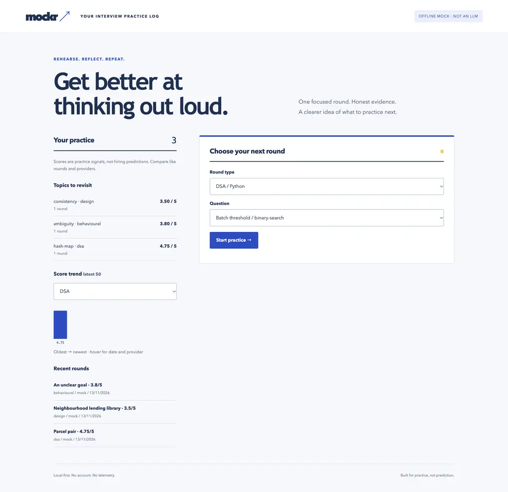
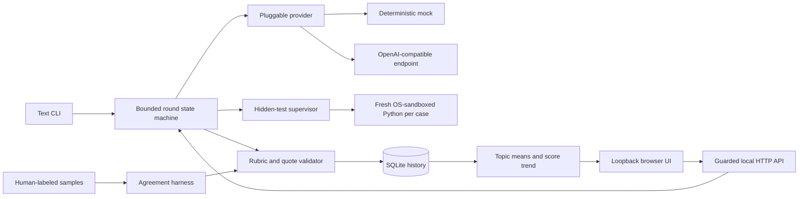

# mockr

A local interview coach built around an OS code sandbox, hidden-test runner and evidence-checked rubric engine. The LLM is one pluggable component.

- Execute Python solutions against hidden cases, with per-case isolation and a parent-enforced timeout.
- Practice DSA, system design and STAR rounds without letting a model skip required stages.
- Keep transcripts and score evidence in SQLite. See weak topics and score trends locally.

**Observed offline demo: 5/5 hidden DSA cases passed; 15 quote-validated scores across three rounds.** No API key needed.

```console
$ uv run mockr demo
mockr demo | OFFLINE MOCK · deterministic heuristic, not an LLM evaluation

DSA | Parcel pair
Scorecard: 4.75/5
5/5 hidden tests · passed
```

Captured opening excerpt. The same run ends with `3 rounds completed · 15 evidence-backed rubric scores`. [Full captured output](docs/demo.txt). Mock scores test the plumbing, not coaching quality.

## Quickstart

Requires [uv](https://docs.astral.sh/uv/), Python 3.12 (uv can install it), and macOS or Linux. On Linux, install bubblewrap first: `sudo apt-get install bubblewrap`. User namespaces must be permitted. Unsupported or broken sandboxes fail closed.

From this repository:

```sh
uv sync --locked --python 3.12
uv run mockr demo
uv run mockr                         # text interview, DSA by default
uv run mockr interview --kind design
uv run mockr interview --kind behavioural
uv run mockr questions               # question ids, types and topics
uv run mockr interview --question dsa-parcel-pair
```

For a code answer, paste a function named `solve` and end with `:end` on its own line. Standard-library imports are supported. Text answers use one line; the browser supports multiline answers. Ctrl+C leaves an unfinished round unsaved.

### Local dashboard and optional voice

```sh
uv run mockr demo --db demo.sqlite3
uv run mockr serve --db demo.sqlite3
# Open http://127.0.0.1:8765
```

The UI starts text rounds, shows evidence scorecards and transcripts, ranks topics by mean score, and plots recent scores by round type. Every history row retains the provider name. Do not interpret mock and real-provider scores as equivalent. The demo database is optional; default persistent history is `~/.local/share/mockr/history.sqlite3`. The default demo uses memory and does not alter your practice history.



Click **Read prompt** for browser speech synthesis or **Dictate answer** for speech recognition. **Stop voice** stops either. Dictation never submits an answer automatically and is disabled for code. Unsupported controls are disabled; typing always works. No paid voice API is used. Recognition support varies, and the browser vendor may process audio remotely. Real microphone permission and speech accuracy were not tested.

### Use an LLM judge

```sh
export MOCKR_BASE_URL=https://api.openai.com/v1
export MOCKR_API_KEY='your-key'
export MOCKR_MODEL='your-model'
uv run mockr interview --provider openai --kind design
uv run mockr serve --provider openai
```

Use any compatible `/chat/completions` service supporting JSON-object output. `MOCKR_BASE_URL` should include its API prefix, not `/chat/completions`. HTTPS is required except for loopback endpoints. Keys come only from the environment; `.env` files are not loaded automatically. Real-provider mode sends the question and candidate transcript to that endpoint and can incur charges. No live paid model was called during verification; a real local HTTP fixture verified the request/response contract and failure handling.

Provider redirects are rejected rather than forwarding your API key to a second destination. Provider failures expose a redacted error, not response bodies or authorization headers.

## How a round works

| Round | Required progression | Scored dimensions |
|---|---|---|
| DSA | approach → Python code → complexity | approach, correctness, complexity, communication |
| System design | requirements → estimates → API → data model → scaling → trade-offs | one criterion per stage |
| Behavioural | situation → task → action → result → reflection | context, ownership, actions, results, reflection |

The coach asks a specific follow-up about the previous answer alongside the next stage. It cannot change the stage sequence. Hidden-case reports reveal counts and status, not expected values or individual case inputs. The bundled bank files are inspectable source, not a secret anti-cheat system.

The real judge receives explicit criterion targets and common anchors for scores 1–5. Every score requires a verbatim candidate quote and improvement feedback. The validator rejects invented quotes, duplicate/missing criteria, out-of-range scores and malformed output. It recomputes the overall mean. Quote provenance is mechanically checked; whether the quote supports the score remains a model-quality question.

The offline mock uses word count for subjective scores and hidden-test pass fraction for correctness. It produces a deterministic answer-referencing probe. It is deliberately simple and is never labeled an LLM.

## Calibration: human labels pending

```console
$ uv run mockr calibrate
Provider: mock
no human labels yet: fill calibration/human_labels.csv
{
  "status": "no human labels yet: fill calibration/human_labels.csv",
  "labeled_criteria": 0,
  "total_criteria": 60,
  "samples": 12
}
```

`calibration/samples/` contains original synthetic answers spanning intended weak, developing, competent and strong responses for each round. `calibration/human_labels.csv` has empty score and rater columns. **No human-agreement numbers are claimed.** Fill scores blind using the rubric anchors, name the actual human rater, then run:

```sh
uv run mockr calibrate --provider openai
# Or use a directory containing samples/*.json and human_labels.csv:
uv run mockr calibrate --provider openai --calibration-dir my-calibration
```

The harness reports exact agreement, within-one agreement, mean absolute error, matched criterion count and per-criterion comparisons. Partial labels are counted explicitly. Unit tests verify the arithmetic with clearly synthetic reference numbers, not purported human ratings. See [the rating protocol](calibration/README.md). The root `calibration` path points to packaged data so the CLI also works after a wheel installation.

## Bring your own question bank

```sh
uv run mockr questions --bank ./my-questions
uv run mockr interview --bank ./my-questions --question custom-sum
uv run mockr serve --bank ./my-questions
```

Each Markdown file begins with one JSON metadata fence and a prompt. IDs must be unique lowercase slugs. `kind` is `dsa`, `design` or `behavioural`. DSA tests are required; `reference` is optional for custom banks and is never sent to the browser or model.

````markdown
```json
{
  "id": "custom-sum",
  "kind": "dsa",
  "title": "Sum readings",
  "topic": "arrays",
  "tests": [
    {"args": [[]], "expected": 0},
    {"args": [[2, -1, 4]], "expected": 5}
  ]
}
```

Write solve(readings) returning the sum of integer readings.
Explain an approach before coding; discuss time and space afterward.
````

Case `args` is the positional argument array. Return JSON-serializable values; canonical JSON equality ignores object key order but distinguishes booleans from integers and integer from float representation. For non-DSA questions omit `tests` and `reference`. All original bundled questions and hidden cases are MIT-licensed with the code.

## Architecture



Python 3.12 keeps the runtime dependency-free: subprocesses, resource limits, SQLite, HTTP and JSON all use the standard library. A second frontend runtime or Postgres server would add setup without improving this single-user core. Tests use pytest; lint and formatting use Ruff. Node is only used for the optional JavaScript syntax check in development/CI, not to run the app.

## What's hard here

- **Running code without exposing your laptop.** OS isolation precedes execution; each case gets a fresh process, resource limits, bounded output and a wall timeout. Interpreter preflight distinguishes host failures from candidate errors.
- **Making model scores inspectable.** The host owns the rubric, exact criterion coverage and quote validation. Model output cannot supply its own rubric or change the computed mean.
- **Keeping a conversational workflow reproducible.** Fixed stage transitions, explicit provider boundaries and immutable completed SQLite records separate dialogue from execution evidence. The mock demo has no random content or time-dependent output; cryptographic identifiers stay out of it.

## Observed results and reproduction

Local verification used macOS arm64 and Python 3.12.15. These are implementation checks, not evidence that a judge predicts interview performance.

| Command | Observed result |
|---|---|
| `uv run mockr demo` | Three completed rounds; 15 quote-validated scores; DSA passed 5/5 cases. Scores: DSA 4.75, design 3.50, behavioural 3.80. |
| `uv run pytest -q --cov=mockr_coach --cov-report=term-missing` | 108 tests passed; 88% statement coverage. The isolated worker is exercised by real subprocess tests but does not contribute in-process coverage. |
| `uv run python -c 'from mockr_coach.bank import load_bank; b=load_bank(); print(f"questions={len(b)} hidden_cases={sum(len(q.tests) for q in b)}")'` | `questions=30 hidden_cases=50` |
| `uv run pytest tests/test_sandbox.py -q` | 21 tests passed, including every bundled DSA reference against all 50 hidden cases and denial of host reads, host writes, network and child processes. |
| `uv run ruff check .` | All checks passed. |
| `uv run ruff format --check .` | All files formatted. |
| `node --check src/mockr_coach/static/app.js` | Exit 0. |
| `uv run mockr calibrate` | No labels: 0 human scores, 60 available criterion cells, 12 samples. |

A real Chromium run completed a STAR round through the UI, saved it, and displayed its 3.80/5 evidence card. At a 390px viewport, document width was 390px with no horizontal overflow. No JavaScript errors were recorded. [Evidence notes](docs/evidence.md). CI is configured for macOS and Linux but has not run remotely; this repository is local only.

## Development

```sh
uv sync --locked --python 3.12
make test
make lint        # includes node --check; use Node 22
make demo
uv build         # build locally; do not publish
```

Tests use real temporary SQLite databases, native sandbox workers and local HTTP servers. The only model double is the explicit offline provider. No API key is required. [DESIGN.md](DESIGN.md) covers contracts, rejected alternatives and interview notes.

## Security and limitations

- This is local practice, not a public hostile-code execution service. Bindings are loopback-only; Host/Origin validation and a per-server token guard browser writes. The UI uses text nodes for untrusted content, a restrictive CSP, no remote scripts, and no telemetry.
- Seatbelt on macOS is deprecated and OS-version-sensitive. Linux needs bubblewrap and enabled user namespaces. Windows is unsupported. Linux isolation has not yet been exercised on this workstation; its CI job is configured, not reported as passed.
- Both backends limit CPU, output size, file descriptors, process creation and wall time. Linux caps address space at 256 MiB. macOS has **no hard memory cap** here. Do not run actively hostile code on a machine with valuable data; use a disposable VM.
- SQLite transcripts are plaintext. Anyone with local file access can read them. There is no authentication, encryption, transcript redaction, session resume or automatic deletion. Use synthetic practice material when privacy matters.
- The single-user HTTP server processes one request at a time. A provider request blocks other requests until it finishes. Interrupted rounds are not saved. The UI keeps at most eight active rounds in memory.
- The tiny calibration set is synthetic and unscored. Semantic judge reliability, score fairness and resistance to all prompt injection are unmeasured. No live LLM or real microphone test was performed.

## Roadmap

Independent human labels and held-out calibration; a microVM execution backend with hard memory limits on every platform; cross-browser microphone and accessibility checks; resumable sessions with idempotent answer submissions. None is represented as implemented.

## License

MIT. All bundled questions, answers and test data were written for this project. No employer code, prompts or data are included.
